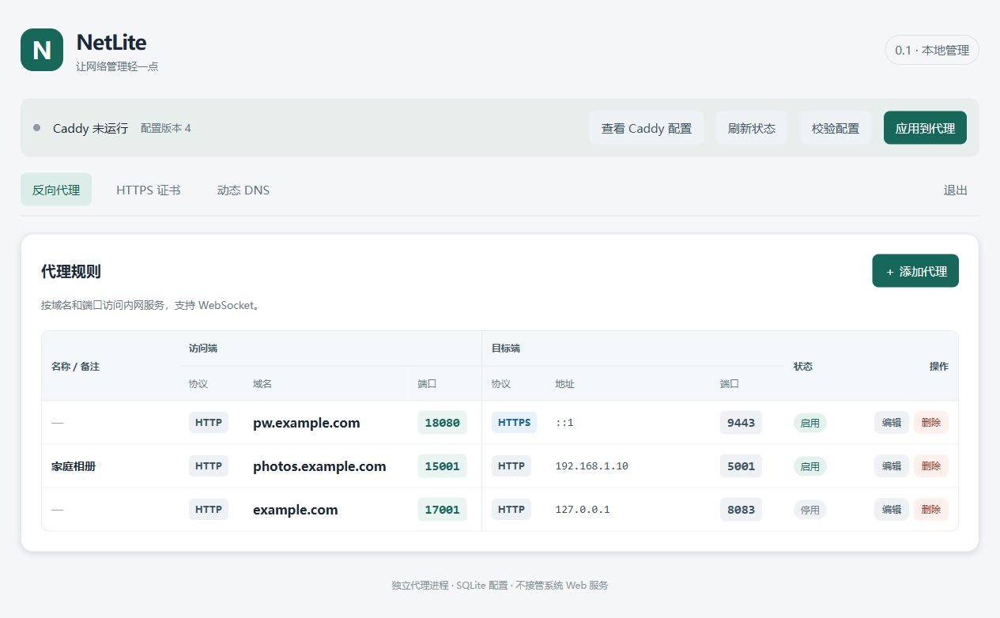
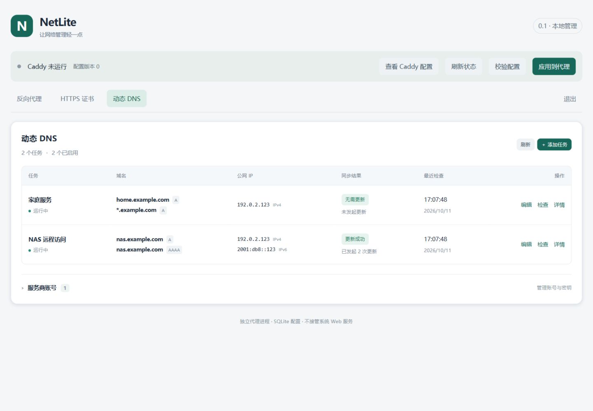
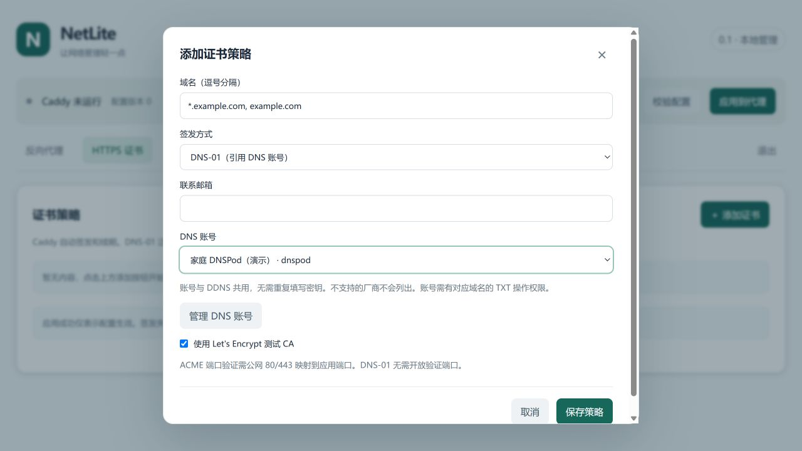
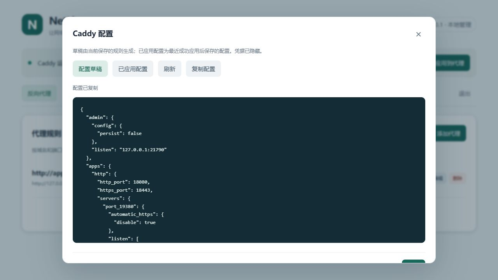

# NetLite

**让网络管理轻一点。**

NetLite 是一款面向 **fnOS（飞牛 NAS）和 Linux 服务器**的轻量网络管理工具。通过一个网页，就可以管理 **DDNS 动态域名、HTTPS 证书和反向代理**，不用为每个服务分别配置证书，也不用手动维护 Caddy 配置文件。

例如：将家里的 NAS、Jellyfin 或其他 Web 服务通过自己的域名开放访问；公网 IP 发生变化时，自动更新域名解析。

> **项目状态：开发与测试阶段（当前应用版本 0.1.5）。** 已提供自动构建、自动化测试与安装包，但 **fnOS 实机安装、ARM64 原生运行、真实 DNS 服务商及公网证书签发仍需验证**。建议先在测试环境使用，并备份重要配置。

[快速安装](#快速安装) · [首次使用](#首次使用) · [使用限制](#使用前需要知道) · [更多文档](#更多文档)

## 可以用 NetLite 做什么？

| 功能 | 对用户有什么用 |
| --- | --- |
| **反向代理** | 让不同域名指向不同的 HTTP/HTTPS 服务；支持 WebSocket、入口端口配置、连通性测试，以及保存草稿后再应用 |
| **DDNS 动态域名** | 自动检查公网 IPv4 / IPv6，在地址变化时更新域名的 A / AAAA 记录；可查看任务状态与检查历史 |
| **HTTPS 证书** | 通过 Let's Encrypt 申请并自动续期证书，支持 DNS-01、HTTP-01，以及 DNS-01 泛域名证书 |
| **DNS 账号共用** | 一次添加 DNS 服务商账号，可同时用于 DDNS 和证书的 DNS 验证 |
| **网页管理** | 在浏览器中配置代理、查看证书状态、处理失败信息，不必直接修改 Caddyfile |

目前支持的 DNS 服务商：

- Cloudflare
- DNSPod.cn（ID / Token）
- 腾讯云 DNSPod
- 阿里云 DNS

证书还支持内部 CA，适合本地测试，但使用前需要在客户端手动信任根证书。

### 界面预览

| 动态域名任务 | DNS 账号与证书 |
| --- | --- |
|  |  |

## 适合哪些场景？

**家庭 NAS：** 为 NAS 上的 Jellyfin、相册、下载服务等 Web 应用配置域名入口。结合 DDNS，应对家庭公网 IP 变化。

**Linux / VPS：** 在一台服务器上管理多个网站或后台服务的反向代理与 HTTPS 证书。Linux 部署可以使用 80 / 443 等常见入口端口（需具备端口绑定权限）。

**只需要其中一种功能：** DDNS 和证书管理可独立使用；不需要先创建反向代理规则。

NetLite 管理的是 **HTTP/HTTPS/WebSocket 反向代理**，不是通用 TCP/UDP 转发工具，也不是内网穿透工具。

## 快速安装

| 运行环境 | 推荐方式 | 适合谁 |
| --- | --- | --- |
| **fnOS / 飞牛 NAS** | 安装 `.fpk` 包 | 希望从飞牛桌面直接管理网络服务的用户 |
| **Linux（systemd）** | 下载 Linux 压缩包，运行 `install.sh` | 希望作为系统服务长期运行的用户 |
| **Linux / Ubuntu / VPS（Docker）** | Docker Compose | 已使用 Docker、希望独立管理部署与升级的用户 |

提供 `amd64` 与 `arm64` 构建产物。**Windows 当前主要用于开发与测试，不提供面向普通用户的 Windows 安装包。**

### 方式一：飞牛 fnOS（FPK）

1. 打开 [GitHub Actions · CI](https://github.com/Simlym/NetLite/actions/workflows/ci.yml)，进入一次**构建成功**的运行。
2. 在页面下方 **Artifacts** 下载 `netlite-packages`，解压外层 ZIP。
3. 选择与 NAS 架构一致的 `netlite-<版本>-amd64.fpk` 或 `netlite-<版本>-arm64.fpk`。
4. 打开飞牛 **应用中心 → 手动安装**，选择该 FPK。
5. 安装成功后，使用**飞牛管理员账号**登录飞牛，从应用入口打开 NetLite。

飞牛版接入了 fnOS **统一网关**：设计上复用飞牛登录态，**不需要再设置 NetLite 管理员密码或输入令牌**；仅允许飞牛管理员访问。它不接管飞牛系统的 Web 服务、证书或信任库。

**注意：** 当前 FPK 要求目标 fnOS 支持统一网关，最低兼容版本及 Socket 权限仍需实机核验。安装包能成功构建不等于已在你的 NAS 上验证通过。如果无法打开入口，请先查看 [飞牛网关说明](docs/FNOS-AUTH.md)，不要直接修改系统 Web 服务。

> Actions 构建产物默认仅保留 **14 天**，并非长期下载链接。当前 GitHub Release 中的旧版本不一定与 `main` 分支一致。构建产物说明见 [下载与构建](docs/BUILD.md)。

### 方式二：Linux / VPS（Docker Compose）

适合使用 **Docker Engine + Compose v2** 的 Linux 服务器。推荐 `host` 网络模式：在网页添加反向代理端口时，不需要反复修改 Docker 的 `ports` 映射。

~~~bash
mkdir -p ~/netlite && cd ~/netlite

curl -fL https://raw.githubusercontent.com/Simlym/NetLite/main/compose.host.yaml -o compose.host.yaml
curl -fL https://raw.githubusercontent.com/Simlym/NetLite/main/deploy/docker.env.example -o .env

# 建议先编辑 .env，将 NETLITE_IMAGE 固定到已验证的版本/提交标签
docker compose -f compose.host.yaml up -d --wait
~~~

默认管理面板只监听服务器本机的 `127.0.0.1:18780`。如果通过 SSH 连接远程服务器，可以在**自己的电脑**运行：

~~~bash
ssh -N -L 18780:127.0.0.1:18780 用户名@服务器地址
~~~

然后在本机浏览器访问 **http://127.0.0.1:18780**。

首次使用时，在**服务器**执行下面的命令，查看一次性初始化码；按网页提示创建管理员账号：

~~~bash
cd ~/netlite
docker compose -f compose.host.yaml exec --user 10001:10001 netlite \
  /opt/netlite/bin/netlite info --data /data
~~~

镜像地址为 `ghcr.io/simlym/netlite`，`main` 为随开发更新的标签。正式使用建议在 `.env` 中固定经过验证的版本或提交哈希。镜像需先由仓库 CI 成功发布，且包的可见性或拉取权限须允许当前服务器使用。

**部署提醒：** `host` 模式面向 Linux；入口端口必须未被其他程序占用，并按需要放行系统防火墙和云安全组。生产环境不建议将初始 HTTP 管理端口直接暴露到公网。

如果你更习惯 Docker 端口映射，也提供 `compose.yaml`（bridge 模式）。两种方式的区别、升级及备份见 [Docker 部署指南](docs/DOCKER.md)。

### 方式三：Linux 原生安装

1. 到 [GitHub Actions · CI](https://github.com/Simlym/NetLite/actions/workflows/ci.yml) 下载 `netlite-packages`。
2. 解压对应架构的 `netlite-<版本>-linux-amd64.tar.gz` 或 `netlite-<版本>-linux-arm64.tar.gz`。
3. 在解压出的目录执行：

~~~bash
sudo bash install.sh
~~~

安装器会引导设置管理端口、访问方式和管理员账号，随后注册并启动 systemd 服务。安装成功时会显示访问地址。

正式包已经包含 NetLite、Caddy 和网页文件，**目标机器不需要安装 Go、Node.js**。账号管理、管理面板 HTTPS 和升级步骤见 [Linux 安装指南](docs/LINUX.md)。

## 首次使用

下面以“使用自己的域名访问 NAS 上的一个 Web 服务”为例。

1. **准备域名与网络。** 确认你控制域名解析；如果希望从公网访问，服务器还需要有实际可达的公网入口，并正确配置路由器端口转发、防火墙或云安全组。
2. **添加 DNS 账号。** 打开左侧「DNS 账号」，添加支持的服务商及 API 凭据。使用 DDNS 或 DNS-01 申请证书时需要此步骤；使用静态 IP 且选 HTTP-01 时则不是必需的。
3. **按需配置动态域名。** 打开「动态域名」，新建任务，填写域名、IPv4 / IPv6 获取地址与检查间隔，启用后查看同步结果。如果公网 IP 固定，可跳过。
4. **申请 HTTPS 证书。** 打开「HTTPS 证书」，填写域名，选择 DNS 验证、HTTP 验证或内部 CA；公网证书填写联系邮箱。保存后后台自动申请，在状态显示为「可用」后继续。
5. **添加反向代理。** 打开「反向代理」，填写访问域名、入口协议与端口、目标服务地址，HTTPS 选择刚刚签发的证书。先「测试目标连接」，再「保存并应用」。
6. **实际访问验证。** 从另一台设备或公网网络访问域名，确认 DNS、端口映射、证书和后端服务均正常。「已监听」只表示 NetLite 已监听端口，**不代表公网一定可达**。

### 一个具体例子

假设你希望通过 `https://jellyfin.example.com` 访问内网的 Jellyfin：

~~~text
浏览器访问 jellyfin.example.com:443
         ↓
域名解析 / DDNS 指向你的公网 IP
         ↓
路由器转发公网 443 → NAS 的 8443（示例）
         ↓
NetLite HTTPS 反向代理（入口 8443）
         ↓
Jellyfin：192.168.1.10:8096
~~~

这里的域名、IP 和端口**仅为示例**，请替换成自己的环境。对于飞牛 NAS，NetLite 的代理入口使用 **1024–65535** 的端口，不直接占用系统 Web 服务所需的 80 / 443；可以由路由器将公网 443 映射到 NAS 的高位端口。Linux 原生 / VPS 则可在满足权限与端口空闲条件时直接监听 443。

### 申请证书时该选哪种验证？

| 方式 | 适用情况 | 需要注意 |
| --- | --- | --- |
| **DNS-01（推荐用于泛域名）** | 想申请 `*.example.com`，或不方便开放公网 80 | 需要支持的 DNS 服务商账号，以及查询、创建、删除 TXT 记录的权限 |
| **HTTP-01** | 单个普通域名，且公网 80 可以访问 | 公网 TCP 80 **必须转发到 NetLite 专用验证监听端口 18082**；不是管理端口 18780 |
| **内部 CA** | 局域网或测试环境 | 证书不会被普通浏览器自动信任，需要手动安装并信任内部根证书 |

Let's Encrypt 可选**正式环境**或**测试环境**。测试环境用于验证配置，签发的证书不被浏览器默认信任；正式证书申请会受 CA 的实际校验及频率限制。证书申请与自动续期的详细规则见 [HTTPS 证书说明](docs/CERTIFICATES.md)。

## 使用前需要知道

- **DDNS 不能代替公网可达性。** 如果运营商使用 CGNAT、没有可用的公网入站连接，单纯更新域名也无法让外网直接访问内网服务；NetLite 当前不提供内网穿透。
- **NetLite 不会接管已有代理服务。** 它运行自己管理的 Caddy，不会修改或停止 fnOS 系统 Web 服务；如果要监听的端口已被占用，需要改端口或调整现有服务。
- **数据目录要整体备份。** 数据库、DNS 主密钥、ACME 账号和 HTTPS 私钥相互关联，只备份数据库可能无法恢复 DNS 凭据。Docker 使用持久化卷；不要使用 `docker compose down -v` 删除数据卷。
- **区分“保存”和“应用”。** 修改代理规则后，只有应用成功才会更新实际监听；DDNS 任务和证书申请不需要应用代理规则即可运行。
- **当前仍在验证阶段。** 自动化测试覆盖大量模拟场景，但不能替代真实 NAS、ARM64、DNS API 和公网访问测试。升级前建议备份数据，重要服务先在测试环境确认。

## 更多文档

| 想了解什么 | 文档 |
| --- | --- |
| 下载哪个包、如何查看 CI 构建产物 | [构建与部署包](docs/BUILD.md) |
| Linux 原生安装、账号恢复、面板 HTTPS | [Linux 安装指南](docs/LINUX.md) |
| Docker host / bridge、升级、数据持久化 | [Docker 部署指南](docs/DOCKER.md) |
| 飞牛登录态、统一网关及实机限制 | [fnOS 认证与接入](docs/FNOS-AUTH.md) |
| DDNS 的更新规则与支持范围 | [DDNS 说明](docs/DDNS-INTEGRATION.md) |
| DNS 账号权限与共用方式 | [DNS 账号](docs/DNS-ACCOUNTS.md) |
| Let's Encrypt、泛域名与证书续期 | [证书管理](docs/CERTIFICATES.md) |
| 管理 API | [API 文档](docs/API.md) |
| 自动化与实机验证范围 | [验证说明](docs/VALIDATION.md) |

## 给开发者

NetLite 使用 **Go + chi + SQLite** 后端、**Vue 3 + TypeScript** 前端，代理引擎当前为 **Caddy**。证书的申请、存储和续期由 NetLite 负责，Caddy 只加载证书并执行 HTTP/HTTPS/WebSocket 反向代理；目前未实现 Nginx Adapter。

源码构建和本地开发可参考 [构建说明](docs/BUILD.md) 与 [Docker 开发流程](docs/DOCKER.md)。主要源码位于 `cmd/netlite/`、`internal/`、`web/`；飞牛打包配置在 `packaging/fnos/`。

欢迎通过 [Issues](https://github.com/Simlym/NetLite/issues) 反馈安装问题或功能建议。提交问题时，请附上部署方式、系统架构、复现步骤和**已脱敏**的日志；不要上传 DNS API 密钥、证书私钥、管理员初始化码或完整数据目录。
